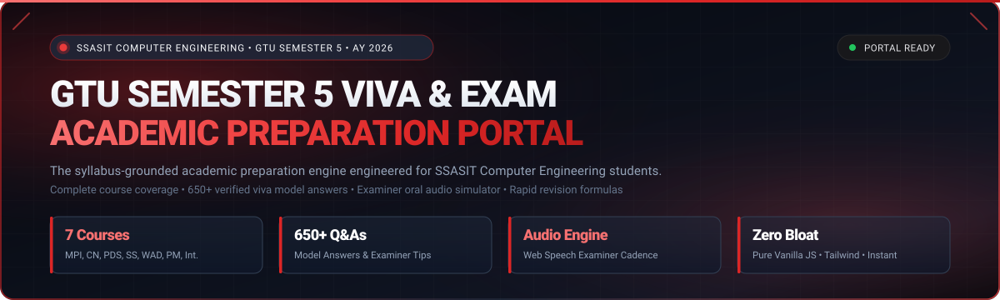
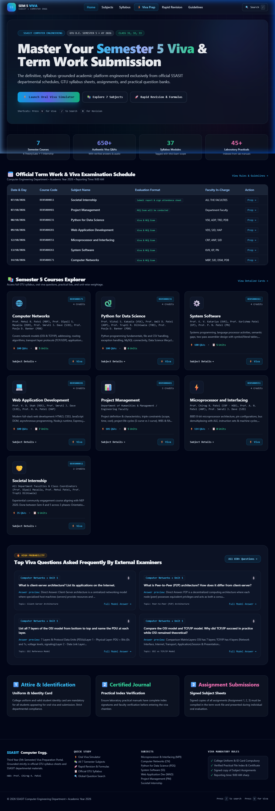
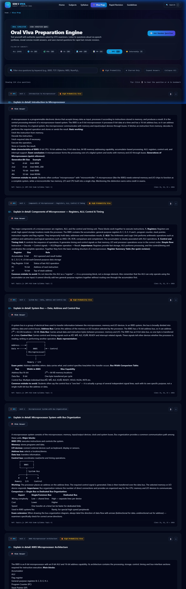
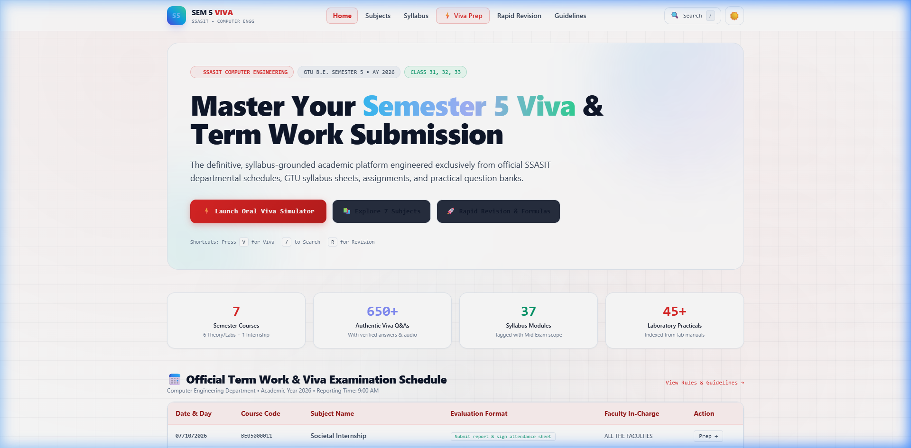

<div align="center">

  

  <br />
  <br />

  <!-- Primary Status Badges -->
  <a href="https://darshil158.github.io/SEM5/">
    
  </a>
  <a href="https://darshil158.github.io/SEM5/">
    
  </a>
  <a href="viva.html">
    
  </a>
  <a href="js/app.js">
    
  </a>
  <a href="LICENSE">
    
  </a>

  <br />
  <br />

  <p align="center">
    <b>Department of Computer Engineering • Shree Swami Atmanand Saraswati Institute of Technology (SSASIT), Surat</b><br />
    <i>Affiliated with Gujarat Technological University (GTU) • Academic Year 2026 • Classes 31, 32, 33</i>
  </p>

  <!-- Quick Navigation Anchors -->
  <p align="center">
    <a href="#overview"><b>Overview</b></a> •
    <a href="#features"><b>Features</b></a> •
    <a href="#schedule"><b>Academic Schedule</b></a> •
    <a href="#courses"><b>Course Matrix (7)</b></a> •
    <a href="#previews"><b>Previews</b></a> •
    <a href="#tech-stack"><b>Tech Stack</b></a> •
    <a href="#structure"><b>Structure</b></a> •
    <a href="#quickstart"><b>Quickstart</b></a> •
    <a href="#live-demo"><b>Live Demo</b></a>
  </p>

  <p align="center">
    <a href="https://darshil158.github.io/SEM5/">
      
    </a>
    <a href="https://darshil158.github.io/SEM5/viva.html">
      
    </a>
    <a href="https://darshil158.github.io/SEM5/revision.html">
      
    </a>
  </p>

</div>


<a id="overview"></a>
## 📖 Project Overview

Preparing for engineering term work submissions, continuous evaluation viva examinations, and mid-semester theory exams is traditionally disrupted by fragmented PDF files, unverified internet question sets, scattered practical codes, and unfamiliarity with external examiners' oral questioning patterns.

The **GTU SEM 5 VIVA & Academic Preparation Portal** is a production-grade, syllabus-grounded academic platform engineered exclusively for **Semester 5 Computer Engineering** students at **Shree Swami Atmanand Saraswati Institute of Technology (SSASIT), Surat**.

### Why This Portal Exists

* **100% Curriculum Fidelity:** Every question, module, syllabus weightage, and practical entry is mapped directly to official GTU syllabus sheets and departmental academic schedules.
* **Audio-Assisted Viva Simulation:** Integrates the browser's native Web Speech API to read viva questions aloud in an examiner's cadence, building auditory comprehension and reducing exam anxiety.
* **Structured Model Answers:** Provides concise 2-to-3 sentence direct answers followed by structured bullet points, register diagrams, architecture tables, reference textbooks, and common examiner traps.
* **Zero Framework Bloat:** Built purely with **HTML5, Tailwind CSS, and Vanilla JavaScript**. Operates instantly with zero npm runtime dependencies, sub-150ms render latency, and complete offline readiness.


<a id="features"></a>
## ⚡ Key Interactive Features

<table>
  <thead>
    <tr>
      <th width="32%">Feature</th>
      <th width="68%">Description &amp; Implementation Details</th>
    </tr>
  </thead>
  <tbody>
    <tr>
      <td><b>🎙️ Oral Viva Simulator &amp; Audio Reader</b><br /><code>viva.html</code></td>
      <td>
        Interactive oral exam simulator housing <b>650+ verified viva questions</b>. Features one-click <b>Web Speech API</b> text-to-speech synthesis simulating an examiner asking questions aloud, quick filters by subject and high-probability tags, and a <b>Random Question Launcher</b>.
      </td>
    </tr>
    <tr>
      <td><b>📚 Collapsible Model Answers &amp; Examiner Tips</b></td>
      <td>
        Every question features an expandable model answer breakdown: direct answer, technical elaboration, ASCII architecture/register diagrams, textbook references (e.g., Ramesh Gaonkar, Tenenbaum, Galvin), and <i>"Common Mistakes to Avoid"</i> notes.
      </td>
    </tr>
    <tr>
      <td><b>🔍 Instant Multi-Index Search</b><br /><code>search.html</code></td>
      <td>
        Sub-millisecond client-side regex search engine indexing across all 650+ questions, 37 syllabus units, formulas, and laboratory practicals with dynamic <code>&lt;mark&gt;</code> keyword highlighting.
      </td>
    </tr>
    <tr>
      <td><b>🚀 Rapid Revision &amp; Formula Engine</b><br /><code>revision.html</code></td>
      <td>
        High-yield academic cheat sheets and formula calculators covering PERT/CPM calculations, 8085 instruction timing and machine cycle equations, TCP 3-way handshake states, COCOMO estimation, and one-click clipboard copying.
      </td>
    </tr>
    <tr>
      <td><b>🌗 Dual Theme Engine (Dark &amp; Light)</b></td>
      <td>
        Features an authentic <b>Deep Midnight Dark Mode</b> alongside a crisp <b>White &amp; Red Accent Light Mode</b>. Theme preferences are persisted seamlessly via <code>localStorage</code> with zero page flicker on refresh.
      </td>
    </tr>
    <tr>
      <td><b>📌 Persistent Elevation Navbar</b></td>
      <td>
        Persistent fixed header (<code>top: 0</code>) with dynamic scroll detection, applying backdrop blur (20px), subtle elevation shadows, and border contrast during downwards scrolling across every page.
      </td>
    </tr>
    <tr>
      <td><b>⌨️ Global Keyboard Navigation</b></td>
      <td>
        Ergonomic desktop hotkeys for power users:
        Press <kbd>/</kbd> to search &bull;
        Press <kbd>V</kbd> for Viva Simulator &bull;
        Press <kbd>S</kbd> for Course Directory &bull;
        Press <kbd>R</kbd> for Revision Hub &bull;
        Press <kbd>H</kbd> for Home Dashboard.
      </td>
    </tr>
  </tbody>
</table>


<a id="schedule"></a>
## 🏛️ Academic Administration & Viva Schedule

### Department Context

| Attribute | Official Verified Detail |
| :--- | :--- |
| **Institution** | Shree Swami Atmanand Saraswati Institute of Technology (SSASIT), Surat |
| **Affiliating University** | Gujarat Technological University (GTU), Ahmedabad |
| **Department** | Computer Engineering Department |
| **Degree Program** | Bachelor of Engineering (B.E.) — 3rd Year (Semester 5) |
| **Academic Year** | 2026 |
| **Enrolled Classes** | Class 31, Class 32, Class 33 |
| **Head of Department (HOD)** | Prof. Chirag R. Patel |
| **Class Coordinators** | **Class 31:** Prof. Dipali S. Masalia<br />**Class 32:** Prof. Mehul B. Patel<br />**Class 33:** Prof. Trupti R. Dilhiwala |

---

### Official Term Work & Viva Examination Schedule (AY 2026)

All examinations commence at **9:00 AM sharp** at the Computer Engineering department laboratories and classrooms.

<table>
  <thead>
    <tr>
      <th>Date &amp; Day</th>
      <th>Course Code</th>
      <th>Subject Name</th>
      <th>Evaluation Format</th>
      <th>Faculty In-Charge</th>
    </tr>
  </thead>
  <tbody>
    <tr>
      <td><b>07/10/2026 (Wed)</b></td>
      <td><code>BE05000011</code></td>
      <td>Societal Internship</td>
      <td>Report Submission &amp; Presentation</td>
      <td>All Department Faculties</td>
    </tr>
    <tr>
      <td><b>07/10/2026 (Wed)</b></td>
      <td><code>BE05000481</code></td>
      <td>Project Management (PM)</td>
      <td>MCQ Examination</td>
      <td>Department Faculty</td>
    </tr>
    <tr>
      <td><b>08/10/2026 (Thu)</b></td>
      <td><code>BE05000231</code></td>
      <td>Python for Data Science (PDS)</td>
      <td>Oral Viva &amp; MCQ Exam</td>
      <td>Prof. Vishal Kakadia, Prof. Amit Patel, Prof. Trupti Dilhiwala, Prof. Pooja Banker</td>
    </tr>
    <tr>
      <td><b>09/10/2026 (Fri)</b></td>
      <td><code>BE05000281</code></td>
      <td>Web Application Development (WAD)</td>
      <td>Oral Viva &amp; MCQ Exam</td>
      <td>Prof. V. D. Shah, Prof. Smruti Dave, Prof. Hardik Patel</td>
    </tr>
    <tr>
      <td><b>12/10/2026 (Mon)</b></td>
      <td><code>BE05000551</code></td>
      <td>Microprocessor and Interfacing (MPI)</td>
      <td>Oral Viva &amp; MCQ Exam</td>
      <td>Prof. Chirag Patel (HOD), Prof. A. N. Patel, Prof. Smruti Dave</td>
    </tr>
    <tr>
      <td><b>13/10/2026 (Tue)</b></td>
      <td><code>BE05000261</code></td>
      <td>System Software (SS)</td>
      <td>Oral Viva &amp; MCQ Exam</td>
      <td>Prof. K. V. Katariya, Prof. Karishma Patel, Prof. P. N. Patel</td>
    </tr>
    <tr>
      <td><b>14/10/2026 (Wed)</b></td>
      <td><code>BE05000171</code></td>
      <td>Computer Networks (CN)</td>
      <td>Oral Viva &amp; MCQ Exam</td>
      <td>Prof. Mehul Patel, Prof. Smruti Dave, Prof. Dipali Masalia, Prof. Pooja Banker</td>
    </tr>
  </tbody>
</table>

> [!IMPORTANT]
> **Mandatory Department Regulations:**
> 1. **Uniform & ID Card:** Full formal college uniform and valid student identity card are strictly compulsory.
> 2. **Practical Journal:** Physical practical manuals must contain a verified index and faculty certificate signed before entering the examination hall.
> 3. **Assignment Files:** Duly signed copies of all subject assignments must be compiled and brought for evaluation.
> 4. **Reporting Time:** Students must report at 9:00 AM sharp on their scheduled dates.


<a id="courses"></a>
## 📚 Semester 5 Course Matrix (7 Subjects)

The portal provides individual subject hubs containing full GTU syllabi, teaching schemes, unit-wise weightage, mid-semester tags, laboratory practical indexes, and comprehensive viva question banks.

<table>
  <thead>
    <tr>
      <th width="8%">Code</th>
      <th width="24%">Subject Name</th>
      <th width="8%">Credits</th>
      <th width="10%">Q&amp;A Bank</th>
      <th width="38%">Core Syllabus &amp; Viva Focus</th>
      <th width="12%">Course Hub</th>
    </tr>
  </thead>
  <tbody>
    <tr>
      <td><code>BE05000551</code></td>
      <td><b>Microprocessor &amp; Interfacing (MPI)</b></td>
      <td><span align="center">5 Cr</span></td>
      <td><b>114 Q&amp;As</b></td>
      <td>8085 architecture, pinout signals, bus organization, addressing modes, instruction set, machine cycles, interrupts, and 8255 PPI interfacing.</td>
      <td><a href="subjects/mpi.html"><code>mpi.html</code></a></td>
    </tr>
    <tr>
      <td><code>BE05000171</code></td>
      <td><b>Computer Networks (CN)</b></td>
      <td><span align="center">4 Cr</span></td>
      <td><b>100 Q&amp;As</b></td>
      <td>OSI &amp; TCP/IP models, framing, sliding window protocols, CRC, IPv4/IPv6 subnetting, CIDR, Dijkstra routing, TCP 3-way handshake, DNS, HTTP.</td>
      <td><a href="subjects/cn.html"><code>cn.html</code></a></td>
    </tr>
    <tr>
      <td><code>BE05000231</code></td>
      <td><b>Python for Data Science (PDS)</b></td>
      <td><span align="center">4 Cr</span></td>
      <td><b>100 Q&amp;As</b></td>
      <td>NumPy ndarray vectorization, Pandas Series &amp; DataFrames, handling missing values, GroupBy aggregations, Matplotlib, Seaborn, and EDA pipelines.</td>
      <td><a href="subjects/pds.html"><code>pds.html</code></a></td>
    </tr>
    <tr>
      <td><code>BE05000261</code></td>
      <td><b>System Software (SS)</b></td>
      <td><span align="center">4 Cr</span></td>
      <td><b>100 Q&amp;As</b></td>
      <td>Language processors, 2-pass assembler design (OPTAB, SYMTAB, LITTAB), macro processors (MNT, MDT, ALA), linkers, loaders, and LEX/YACC compiler phases.</td>
      <td><a href="subjects/ss.html"><code>ss.html</code></a></td>
    </tr>
    <tr>
      <td><code>BE05000281</code></td>
      <td><b>Web Application Development (WAD)</b></td>
      <td><span align="center">4 Cr</span></td>
      <td><b>100 Q&amp;As</b></td>
      <td>HTML5 semantic markup, CSS3 layouts, JavaScript DOM manipulation, Asynchronous Fetch API, PHP form handling, MySQL PDO, session state, REST APIs.</td>
      <td><a href="subjects/wad.html"><code>wad.html</code></a></td>
    </tr>
    <tr>
      <td><code>BE05000481</code></td>
      <td><b>Project Management (PM)</b></td>
      <td><span align="center">3 Cr</span></td>
      <td><b>101 Q&amp;As</b></td>
      <td>Project life cycle, Work Breakdown Structure (WBS), network scheduling (CPM &amp; PERT), risk mitigation, COCOMO cost models, and Agile Scrum framework.</td>
      <td><a href="subjects/pm.html"><code>pm.html</code></a></td>
    </tr>
    <tr>
      <td><code>BE05000011</code></td>
      <td><b>Societal Internship</b></td>
      <td><span align="center">2 Cr</span></td>
      <td><b>35 Q&amp;As</b></td>
      <td>Community fieldwork, social problem identification, 60-hour fieldwork logbook, NGO collaboration, project reporting, and UN SDGs alignment.</td>
      <td><a href="subjects/internship.html"><code>internship.html</code></a></td>
    </tr>
  </tbody>
</table>


<a id="previews"></a>
## 🖼️ Visual Showcase & Previews

<div align="center">

### Executive Dashboard & Course Explorer (Dark Mode)
*Responsive desktop dashboard featuring live statistics, official schedule table, course directory, and quick actions.*



<br />
<br />

### Oral Viva Simulator & Voice Speech Engine
*Question simulator with subject filters, speech synthesis button, expandable model answers, and examiner tips.*



<br />
<br />

### High-Contrast Light Mode with Crimson Red Accents
*Complete light theme featuring clean white surfaces, dark readable typography, red highlights, and persistent navbar.*



</div>


<a id="tech-stack"></a>
## 🛠️ Technology Stack & Architecture

This platform was purposely architected without monolithic JavaScript frameworks to guarantee instant page loads, zero compilation steps, and permanent reliability.

```
┌────────────────────────────────────────────────────────────────────────┐
│                        CLIENT BROWSER (NO BUILD STEP)                  │
├────────────────────────────────────────────────────────────────────────┤
│  HTML5 Semantic Structure       Tailwind CSS CDN + style.css Tokens    │
│  ├── index.html, subjects.html   ├── Design System Tokens (--bg, etc.) │
│  ├── viva.html, search.html      ├── Light / Dark Class Switcher       │
│  └── syllabus.html, etc.         └── Fixed Elevation Navbar Observer   │
├────────────────────────────────────────────────────────────────────────┤
│  VANILLA JAVASCRIPT ENGINE (ES6+)                                      │
│  ├── js/data.js        → Master Academic DB (650+ Q&As, Syllabi)       │
│  ├── js/app.js         → Shortcuts, Speech Audio, Theme Persistence    │
│  ├── js/navigation.js  → Shared Fixed Header, Breadcrumbs & Footer     │
│  ├── js/viva.js        → Interactive Filtering, Search & Expanders    │
│  ├── js/search.js      → Instant Regex Search & <mark> Highlighting    │
│  └── js/revision.js    → Interactive Formula Calculators & Clipboard   │
├────────────────────────────────────────────────────────────────────────┤
│  BROWSER APIS: Web Speech API • localStorage • Clipboard API           │
└────────────────────────────────────────────────────────────────────────┘
```

### Core Technologies

* **HTML5:** Semantic document outlines, accessible interactive components, and SEO-optimized metadata.
* **Tailwind CSS (v3.x CDN) & Vanilla CSS (`css/style.css`):** Utility styling augmented with centralized design tokens (`--bg-primary`, `--text-primary`, `--accent-red`, `--border-color`) powering both dark and light modes.
* **Vanilla JavaScript (ES6+):** Pure client-side logic with zero runtime dependencies.
* **Web Speech API (`window.speechSynthesis`):** Native hardware speech synthesis for examiner voice simulations.
* **Web Storage API (`localStorage`):** Synchronous persistence for theme preferences and starred questions.
* **Clipboard API (`navigator.clipboard`):** Native formula copying for revision notes.


<a id="structure"></a>
## 📂 Repository Structure

```
SEM5-VIVA/
├── index.html                   # Mission Control Dashboard & Official Schedule
├── subjects.html                # Complete 7-Course Directory & GTU Credit Matrix
├── syllabus.html                # GTU Syllabus Browser with Mid-Exam Tags
├── viva.html                    # Interactive Oral Viva Simulator (650+ Q&As)
├── search.html                  # Global Multi-Index Search Engine
├── revision.html                # Rapid Revision, Formulas & Cheat Sheets
├── about.html                   # Department Regulations & Faculty Directory
│
├── subjects/                    # Dedicated Individual Course Portals
│   ├── mpi.html                 # Microprocessor & Interfacing Hub (BE05000551)
│   ├── cn.html                  # Computer Networks Hub (BE05000171)
│   ├── pds.html                 # Python for Data Science Hub (BE05000231)
│   ├── ss.html                  # System Software Hub (BE05000261)
│   ├── wad.html                 # Web Application Development Hub (BE05000281)
│   ├── pm.html                  # Project Management Hub (BE05000481)
│   └── internship.html          # Societal Internship Hub (BE05000011)
│
├── css/
│   └── style.css                # Centralized Design Tokens, Elevation & Print Styles
│
├── js/
│   ├── data.js                  # Master Academic Database (940 KB, 650+ Q&As)
│   ├── app.js                   # State, SpeechSynthesis, Shortcuts, Theme Manager
│   ├── navigation.js            # Unified Fixed Topbar, Breadcrumbs & Footer
│   ├── viva.js                  # Viva Filtering, Audio Engine & Expanders
│   ├── search.js                # Instant Regex Multi-Index Search Engine
│   ├── revision.js              # Formula Cards & Clipboard Utility
│   └── subject-page.js          # Dynamic Subject Course Renderer
│
└── assets/
    └── readme/                  # High-Resolution Showcase Media & Badges
        ├── hero-banner.svg      # Custom Black, White & Red Hero Vector Banner
        ├── section-divider.svg  # Crimson Gradient Divider Vector
        ├── preview-dashboard-dark.png   # Full Dashboard Preview (Dark)
        ├── preview-viva-simulator.png   # Viva Simulator & Audio Preview
        └── preview-light-mode.png       # Light Theme Preview with Red Accents
```


<a id="quickstart"></a>
## 🚀 Getting Started & Local Execution

Because this project uses standard browser technologies with zero compilation or bundling required, running it locally is effortless:

### 1. Clone the Repository

```bash
git clone https://github.com/darshil158/SEM5.git
cd SEM5
```

### 2. Run with Any Static Server

#### Option A: VS Code Live Server (Recommended)
1. Install the **Live Server** extension in VS Code.
2. Right-click on `index.html` and select **"Open with Live Server"**.

#### Option B: Python 3 HTTP Server
```bash
python -m http.server 8080
```
Open [http://localhost:8080](http://localhost:8080) in your web browser.

#### Option C: Node.js `npx serve`
```bash
npx serve .
```

#### Option D: Direct File Open
You can also directly double-click `index.html` or open it using any modern web browser without a web server.


<a id="live-demo"></a>
## 🌐 Live Deployment

The portal is continuously deployed to GitHub Pages and accessible worldwide:

* **Production URL:** [https://darshil158.github.io/SEM5/](https://darshil158.github.io/SEM5/)
* **Repository:** [https://github.com/darshil158/SEM5](https://github.com/darshil158/SEM5)
* **Branch:** `main`
* **Hosting:** GitHub Pages Static CDN


<a id="credits"></a>
## 📜 Academic Integrity, Credits & License

* **Departmental Alignment:** Built with strict adherence to official syllabus guidelines, examination circulars, and course outcomes provided by the **Department of Computer Engineering, Shree Swami Atmanand Saraswati Institute of Technology (SSASIT), Surat**, and **Gujarat Technological University (GTU)**.
* **Academic Disclaimer:** This platform is designed exclusively as an educational study aid and preparation portal. Examination schedules, faculty assignments, and syllabus requirements are subject to official university and departmental notices.
* **License:** Distributed under the open-source **MIT License**. See [`LICENSE`](LICENSE) for complete terms.

---

<div align="center">
  <sub>Engineered for academic excellence • Department of Computer Engineering • SSASIT Surat</sub><br />
  <sub>© 2026 SSASIT Computer Engineering Department • Class 31, 32, 33</sub>
</div>
